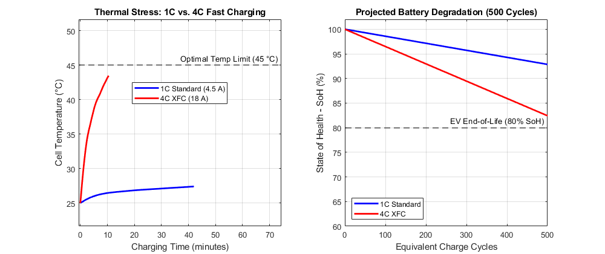
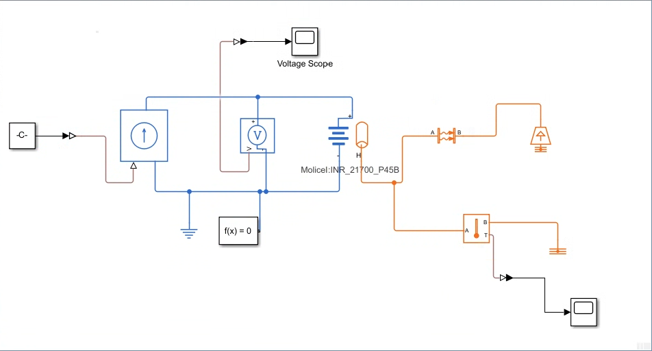

# EV Fast-Charging (XFC) Electro-Thermal Stress & Battery Degradation Simulation

A coupled electro-thermal and aging simulation of a **Molicel INR-21700-P45B (4.5 Ah)** lithium-ion cell built in **MATLAB, Simulink, and Simscape Battery**. This project quantifies the thermal stress and 500-cycle State of Health (SoH) trade-offs between standard **1C charging (4.5 A)** and **4C Extreme Fast Charging (18 A)** from 10% to 80% SoC.



---

## Key Engineering Findings

| Charging Protocol | Cooling Condition ($h$) | Charging Time (10–80% SoC) | Peak Cell Temp (°C) | Projected SoH (500 Cycles) |
| :--- | :--- | :---: | :---: | :---: |
| **1C Standard (4.5 A)** | Passive Air ($15\text{ W/m}^2\cdot\text{K}$) | 42.0 min | ~27.4 °C | ~93.0% |
| **4C XFC (18 A)** | Passive Air ($15\text{ W/m}^2\cdot\text{K}$) | 10.5 min | ~43.5 °C | ~82.5% |
| **4C XFC (18 A)** | Active Liquid ($250\text{ W/m}^2\cdot\text{K}$) | 10.5 min | ~27.6 °C | ~88.3% |

* **Thermal Bottleneck:** Under passive air cooling, 4C fast charging drives cell temperature up by **+18.5 °C** in 10.5 minutes, approaching the 45 °C optimal operating limit. Switching to active liquid cooling ($250\text{ W/m}^2\cdot\text{K}$) suppresses the 4C peak temperature to **27.6 °C** (~16 °C reduction).
* **Degradation Impact:** Under passive air cooling, the combined thermal acceleration and high C-rate stress reduce 500-cycle capacity retention from **~93.0% SoH (1C)** to **~82.5% SoH (4C)**, pushing the cell close to the standard 80% EV End-of-Life (EoL) threshold.

---

## System Architecture



The Simulink model (`XFC_Battery_Model.slx`) couples three domains:
1. **Electrical Domain (1RC ECM):** Datasheet-parameterized **Molicel INR-21700-P45B** block with SOC- and temperature-dependent Open-Circuit Voltage ($OCV$), instantaneous resistance ($R_0$), and polarization dynamics ($R_1, \tau_1$) driven by a `Controlled Current Source`.
2. **Thermal Domain:** Lumped-parameter thermal mass ($63\text{ J/K}$) coupled to a `Convective Heat Transfer` boundary ($A = 0.0053\text{ m}^2$) and a constant `Temperature Source` ($25\ ^\circ\text{C}$ / $298.15\text{ K}$).
3. **Degradation Post-Processing (`run_XFC_analysis.m`):** Automated MATLAB script that executes both charge profiles, extracts Simscape `simlog` temperature histories, and projects 500-cycle capacity fade using an **Arrhenius thermal acceleration model** combined with a semi-empirical **C-rate stress factor**:

$$AF = \exp\left(-\frac{E_a}{R} \left(\frac{1}{T_{\text{mean}}} - \frac{1}{T_{\text{ref}}}\right)\right)$$

* $E_a = 31.5\text{ kJ/mol}$ (SEI growth activation energy)
* $R = 8.314\text{ J/(mol}\cdot\text{K)}$
* $T_{\text{ref}} = 298.15\text{ K}$ ($25\ ^\circ\text{C}$)
* 4C C-rate stress multiplier: $1.6\times$ (accounting for lithium plating and mechanical stress)

---

## Cell & Boundary Parameters

* **Cell:** Molicel INR-21700-P45B (Cylindrical 21700, 4.5 Ah nominal)
* **Initial SoC / Ambient Temp:** 10% SoC / 25 °C (298.15 K)
* **Thermal Mass:** `63 J/K`
* **Cooling Surface Area:** `0.0053 m²`
* **Convective Coefficient ($h$):** `15 W/(m²·K)` (passive air) / `250 W/(m²·K)` (active liquid)

---

## Repository Structure

```text
├── XFC_Battery_Model.slx       # Coupled 1RC electro-thermal Simulink/Simscape model
├── run_XFC_analysis.m          # Automation script for 1C vs. 4C sweeps & SoH plotting
├── Simulink_Architecture.png   # Block diagram of the Simscape model
├── XFC_Comparison_Plot.png     # Thermal profile & 500-cycle SoH comparison figure
└── README.md                   # Project documentation
